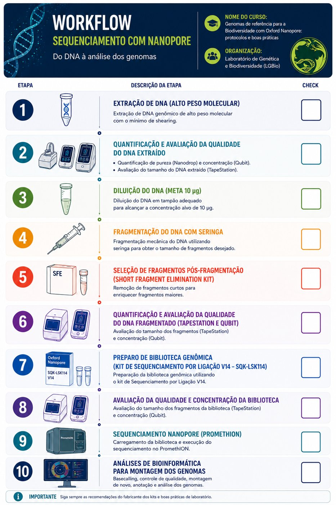

# Curso de Ensamblaje de Genomas de Referencia con datos Nanopore

!!! info "Edición 2026"
    **Del 16 al 27 de noviembre de 2026** · Laboratório de Genética & Biodiversidade (LGBio), Instituto de Ciências Biológicas I, Campus II de la Universidade Federal de Goiás, Goiânia (GO), Brasil.

!!! note "Idioma"
    El curso se imparte en **portugués**. Los protocolos están disponibles en portugués.

## :material-information: Información general

| Ítem | Detalle |
| --- | --- |
| **Fechas** | Del 16 al 27 de noviembre de 2026 (dos semanas) |
| **Lugar** | LGBio/ICB, Universidade Federal de Goiás (UFG), Goiânia, Brasil |
| **Modalidad** | Presencial |
| **Idioma** | Portugués |
| **Coordinación** | Dra. Mariana Pires de Campos Telles |
| **Responsables** | Dra. Mariana Pires de Campos Telles, Dra. Cíntia Pelegrineti Targueta, Dra. Carmen Elena Barragan Ruiz, Dra. Renata de Oliveira Dias, Dr. Rhewter Nunes y Dra. Ramilla dos Santos Braga Ferreira |

## :material-text-box-outline: Programa

El curso aborda los principios, protocolos y herramientas necesarios para generar genomas de referencia de la biodiversidad, siguiendo las recomendaciones internacionales de calidad del [Earth BioGenome Project (EBP)](https://www.earthbiogenome.org/). Se presentan todas las etapas del flujo de trabajo: planificación del muestreo, obtención de ADN de alto peso molecular, preparación de bibliotecas Oxford Nanopore, secuenciación de lecturas largas, controles de calidad, ensamblaje de los genomas, *scaffolding*, anotación, curaduría y depósito de los datos en repositorios públicos.

La parte práctica incluye la preparación de bibliotecas con el *Ligation Sequencing Kit* (SQK-LSK114), la secuenciación en la plataforma Oxford Nanopore PromethION 2 (P2) y la ejecución de *pipelines* bioinformáticos para el ensamblaje y la evaluación de genomas de referencia.

!!! warning "Requisito previo"
    Es necesario iniciar el curso con el **ADN de alto peso molecular ya extraído**.

## :material-sitemap-outline: Flujo de trabajo

<figure markdown>
  { width="520" loading=lazy }
  <figcaption>Flujo de trabajo del curso (figura original en portugués).</figcaption>
</figure>

## :material-book-open-variant: Módulos

-   :material-flask-outline:{ .lg .middle } __Parte 1 · Laboratorio__

    ---

    Control de calidad del ADN, fragmentación, selección de fragmentos, preparación de bibliotecas (SQK-LSK114) y secuenciación en el PromethION 2.

    :octicons-check-circle-fill-24:{ .green } **Disponible (en portugués)**

    [:octicons-arrow-right-24: Protocolos de laboratorio](bancada.md)

-   :material-console:{ .lg .middle } __Parte 2 · Bioinformática__

    ---

    Control de calidad de las lecturas, ensamblaje, evaluación, *scaffolding*, anotación, curaduría y depósito de los datos.

    :octicons-clock-fill-24:{ .yellow } **En construcción**

    [:octicons-arrow-right-24: Bioinformática](bioinformatica.md)

