# Parte 1 · Bancada

Protocolos utilizados no [Curso de Montagem de Genomas de Referência com dados Nanopore](index.md), do DNA de alto peso molecular até o sequenciamento na plataforma Oxford Nanopore PromethION 2 (P2).

!!! warning "Antes de começar"
    O curso inicia com o **DNA de alto peso molecular já extraído**. A Etapa 1 apresenta os protocolos de extração recomendados para cada tipo de organismo.

## :material-format-list-checks: Etapas

| Etapa | Descrição |
| :---: | --- |
| 1 | [Extração de DNA de alto peso molecular](#etapa-1-extracao-de-dna-de-alto-peso-molecular) |
| 2 | [Controle de qualidade do DNA extraído](#etapa-2-controle-de-qualidade-do-dna-extraido) |
| 3 | [Diluição do DNA](#etapa-3-diluicao-do-dna) |
| 4 | [Fragmentação do DNA](#etapa-4-fragmentacao-do-dna) |
| 5 | [Seleção de fragmentos após a fragmentação](#etapa-5-selecao-de-fragmentos-de-dna) |
| 6 | [Controle de qualidade após a fragmentação](#etapa-6-controle-de-qualidade-apos-a-fragmentacao) |
| 7 | [Preparo da biblioteca genômica (SQK-LSK114)](#etapa-7-preparo-da-biblioteca-genomica) |
| 8 | [Quantificação da biblioteca](#etapa-8-quantificacao-da-biblioteca) |
| 9 | [Sequenciamento no PromethION 2](#etapa-9-sequenciamento) |
| — | [Protocolos de apoio: TapeStation e Qubit](#protocolos-de-apoio) |

---

## Etapa 1 · Extração de DNA de alto peso molecular

Para o sequenciamento de fragmentos longos com a tecnologia Oxford Nanopore, é necessário obter DNA de alto peso molecular, com o mínimo possível de fragmentação e de contaminantes. Para isso, existem procedimentos otimizados, tanto protocolos caseiros quanto kits comerciais.

**Tabela 1.** Protocolos de extração utilizados pelo grupo para diferentes organismos.

| Grupo | Tecido | Protocolo de extração |
| --- | --- | --- |
| Plantas | Folhas | Extração HMW para plantas (protocolo caseiro) |
| Fungos | Micélio | Extração HMW para plantas (protocolo caseiro) |
| Animais | Sangue | Monarch HMW DNA Extraction Kit para sangue (T3050) |
| Animais | Músculo | Monarch HMW DNA Extraction Kit para tecido (T3060) |
| Animais | Insetos (corpo) | Monarch HMW DNA Extraction Kit para tecido (T3060) |

!!! note "Observação"
    Os protocolos detalhados de extração são disponibilizados pela coordenação do curso.

---

## Etapa 2 · Controle de qualidade do DNA extraído

O controle de qualidade começa pela avaliação da **pureza** no Nanodrop. Em seguida, avalia-se a **integridade** do DNA por eletroforese capilar no TapeStation e faz-se a **quantificação** com os reagentes Qubit Broad Range.

1. Pureza: [Nanodrop](#avaliacao-de-acidos-nucleicos-nanodrop) (abaixo)
2. Integridade: [TapeStation, DNA genômico](#controle-de-qualidade-de-dna-genomico-tapestation)
3. Quantificação: [Qubit dsDNA Broad Range](#quantificacao-de-dna-qubit)

### Avaliação de ácidos nucleicos (Nanodrop)

O Nanodrop (ThermoFisher) quantifica e avalia a pureza de ácidos nucleicos por espectrofotometria UV-Vis de microvolumes. O DNA absorve a 260 nm, as proteínas a 280 nm, e contaminantes como fenol, sais e carboidratos a 230 nm.

**Reagentes e materiais:** equipamento Nanodrop (ThermoFisher), computador, amostras de ácidos nucleicos, água ou tampão de eluição, ponteiras, pipetas e papel para limpeza.

**Procedimento:**

1. Ligue o computador e abra o software do Nanodrop.
2. Faça a medida do branco com água ou com o mesmo tampão usado para eluir o DNA na extração.
3. Pipete 1 a 2 µL de água ou tampão no pedestal, abaixe o braço do Nanodrop e clique em **Blank**.
4. Limpe o pedestal com papel limpo, fino e seco.
5. Pipete 1 µL da amostra no pedestal, abaixe o braço e clique em **Measure**.
6. Anote ou salve a concentração e as razões.
7. Limpe o pedestal com papel limpo, fino e seco.
8. Meça a próxima amostra.
9. Não é necessário medir o branco entre as amostras, mas é recomendado lê-lo novamente a cada 30 minutos.

<figure markdown>
  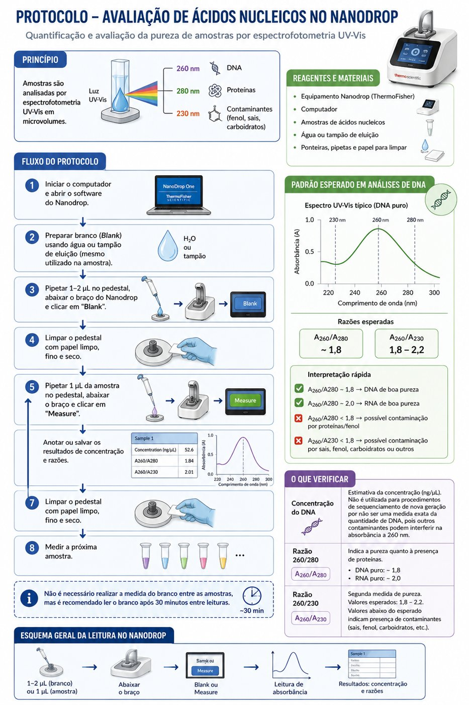{ width="560" loading=lazy }
  <figcaption>Resumo do protocolo no Nanodrop.</figcaption>
</figure>

<figure markdown>
  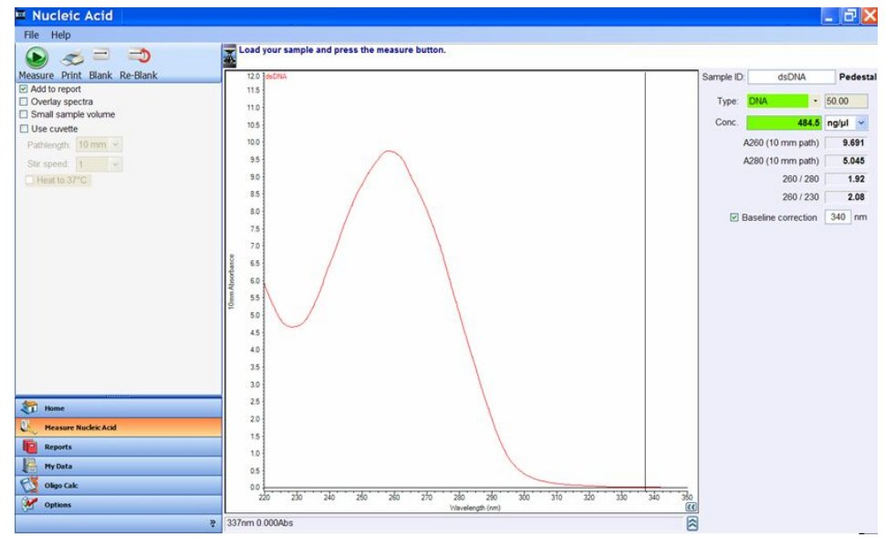{ width="560" loading=lazy }
  <figcaption>Padrão esperado em análises de DNA.</figcaption>
</figure>

**Como interpretar:**

| Medida | Significado | Valor esperado |
| --- | --- | --- |
| **Concentração (ng/µL)** | Estimativa da concentração. Não é usada para sequenciamento, pois contaminantes interferem na absorbância a 260 nm. | — |
| **Razão 260/280** | Pureza em relação a proteínas. | ~1,8 (DNA) · ~2,0 (RNA) |
| **Razão 260/230** | Pureza em relação a outros contaminantes. Valores baixos indicam contaminação. | 1,8 a 2,2 |

---

## Etapa 3 · Diluição do DNA

Dilui-se o DNA de alto peso molecular para a etapa de fragmentação. O objetivo é obter **no mínimo 100 ng/µL em um volume mínimo de 200 µL**.

<figure markdown>
  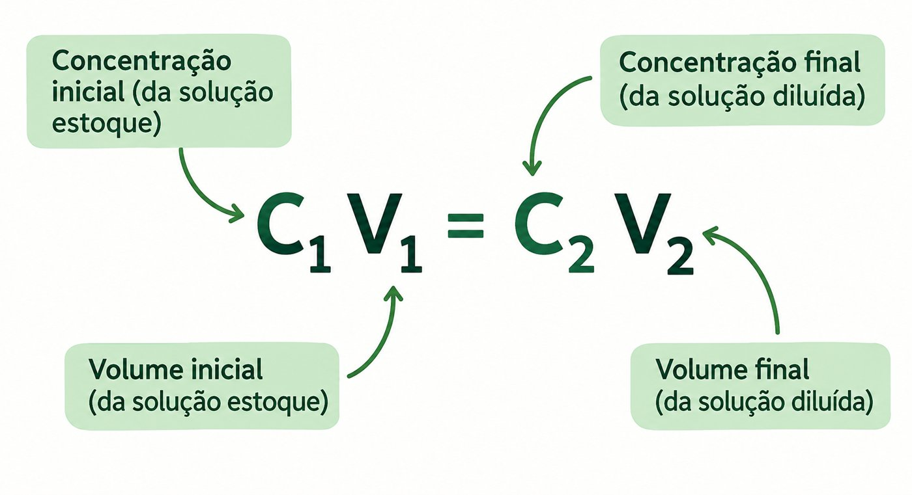{ width="420" loading=lazy }
  <figcaption>C1V1 = C2V2: concentração e volume da solução estoque (1) e da solução diluída (2).</figcaption>
</figure>

**Reagentes e materiais:** DNA de alto peso molecular, tampão de eluição ou Tris-HCl 10 mM pH 8,5, tubos de 1,5 mL.

**Procedimento:**

1. Após a quantificação do DNA, faça os cálculos com a fórmula acima.
2. Dilua uma alíquota de DNA, adicionando o volume calculado de DNA e completando com tampão de eluição ou Tris-HCl.

---

## Etapa 4 · Fragmentação do DNA

A fragmentação controlada com seringa e agulha de insulina é necessária para a inserção dos adaptadores de sequenciamento nas extremidades das moléculas. Ela não pode ser intensa, pois é preciso manter fragmentos grandes para o sequenciamento de leituras longas. Essa etapa é **opcional** e ajuda a obter moléculas de comprimento mais uniforme, maximizando o rendimento do sequenciamento.

*Adaptado de* DNA clean-up and size selection for long-read sequencing V.4.

| Agulha | Passagens | N50 estimado |
| :---: | :---: | :---: |
| 26G | 20 a 40 | 40 kb |
| 29G | 10 a 20 | 20–35 kb |

**Procedimento:**

1. Coloque uma alíquota de aproximadamente 15 µg de DNA (100 ng/µL) em um tubo Eppendorf DNA LoBind de 1,5 mL. Ajuste o volume para exatamente 200 µL com EB (kit Monarch) ou TE pH 8.
2. Conecte a agulha à seringa e faça de 20 a 40 passagens, ou seja, aspire e dispense o DNA de 20 a 40 vezes.
3. As passagens devem ser o mais uniformes possível.
4. Após a fragmentação, faça o [controle de qualidade no TapeStation](#controle-de-qualidade-de-dna-genomico-tapestation) para verificar o resultado.

!!! tip "Quando fragmentar"
    A fragmentação deve ser feita em amostras com perfil de DNA **acima de 60 kb** no TapeStation.

---

## Etapa 5 · Seleção de fragmentos de DNA

Esta etapa elimina fragmentos **menores que 10 kb**, gerados na extração ou na fragmentação com seringa. É opcional e depende da quantidade inicial de DNA: **não é recomendada quando há menos de 10 µg de DNA total**.

### Short Fragment Eliminator Kit (EXP-SFE001), Oxford Nanopore

O kit remove fragmentos curtos (< 10 kb) de amostras de DNA genômico. O DNA é misturado a um volume igual de tampão SFE e centrifugado para precipitar o DNA de alto peso molecular, que é depois ressuspendido em solução aquosa.

*Traduzido e adaptado de* [nanoporetech.com/document/requirements/sfe-know-how](https://nanoporetech.com/document/requirements/sfe-know-how).

**Equipamentos e materiais:** Short Fragment Eliminator Kit (EXP-SFE001), ponteiras comuns e de ponta larga (*wide-bore*), etanol 80% recém-preparado, 3 a 10 µg de DNA de alto peso molecular, tubos Eppendorf DNA LoBind de 1,5 mL e centrífuga de microtubos.

??? info "Recomendações (clique para expandir)"
    1. **Massa de DNA:** entre 3 e 10 µg. Com menos de 3 µg não haverá DNA suficiente para o preparo da biblioteca.
    2. **Solução tampão:** armazene as amostras em TE. Outras soluções podem reduzir a eficiência da seleção de tamanho.
    3. **Homogeneidade da amostra:** é essencial, sobretudo para DNA de alto peso molecular. Meça no Qubit as partes inferior, média e superior da amostra. Se as leituras forem inconsistentes (CV > 20%), incube a 50 °C com agitação suave ou misture delicadamente com pipeta *wide-bore*, garantindo que todo o volume seja misturado.
    4. **Viscosidade do SFE:** o tampão é viscoso. Misture todo o volume com a pipeta 10 a 15 vezes antes de usar e garanta que esteja à temperatura ambiente.
    5. **Centrifugação:** ajuste a centrífuga para 22 °C e só coloque as amostras quando essa temperatura for atingida. O *pellet* pode ser difícil de ver: posicione a dobradiça do tubo voltada para fora no rotor, de modo que o *pellet* fique do lado da dobradiça, e aspire o sobrenadante pelo lado oposto.

<figure markdown>
  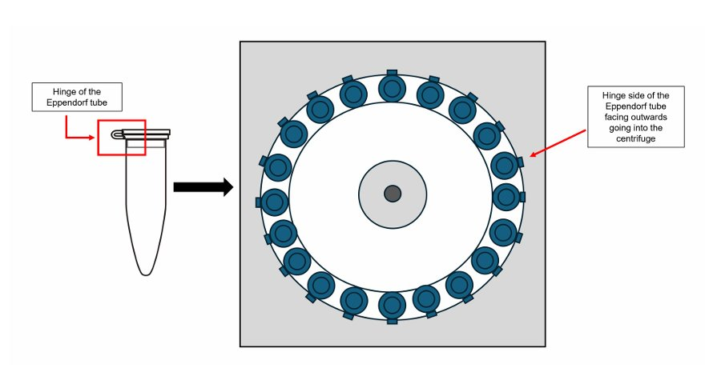{ width="480" loading=lazy }
  <figcaption>Posicione a dobradiça do tubo voltada para fora do rotor.</figcaption>
</figure>

**Procedimento:**

1. Em um tubo Eppendorf DNA LoBind de 1,5 mL, adicione 100 µL de DNA a 100 ng/µL (10 µg de DNA).
2. Certifique-se de que o tampão SFE está à temperatura ambiente.
3. Adicione um volume igual (100 µL) de tampão SFE à amostra.
4. Com uma ponteira *wide-bore* ajustada para 200 µL, misture lenta e suavemente 10 a 15 vezes, até a solução ficar homogênea.
5. Coloque o tubo na centrífuga com a dobradiça voltada para fora e equilibre com outros tubos. Confira a orientação e a temperatura antes de iniciar.
6. Centrifugue a 10.000 × g, a 22 °C, por 30 minutos.
7. Com uma ponteira de calibre estreito, remova lentamente a maior parte do sobrenadante (deixando ~15–20 µL), aspirando pelo lado oposto ao *pellet*, e descarte.
8. Lave com etanol:
    1. Adicione lentamente 200 µL de etanol 80% recém-preparado, pelo lado oposto ao *pellet*, sem perturbá-lo.
    2. Centrifugue a 10.000 × g por 3 minutos, com a mesma orientação dos tubos (dobradiça para fora).
    3. Com uma ponteira de calibre estreito, aspire lentamente o sobrenadante pelo lado oposto, sem perturbar o *pellet*.
9. Após a primeira lavagem, o *pellet* costuma ficar mais visível (branco, no fundo, do lado da dobradiça). Se estiver visível, descarte o máximo de etanol possível. Se não estiver, deixe ~20 µL de sobrenadante para não aspirá-lo por engano.
10. Repita a lavagem (passo 8), totalizando duas lavagens. Depois da segunda, o *pellet* geralmente fica bem visível, e o etanol residual pode ser retirado com uma pipeta de 10 µL.
11. Elua o DNA: adicione 50 µL de TE (10 mM Tris-HCl, 0,1 mM EDTA, pH 8,0) e misture com ponteira *wide-bore*.
12. Incube em termomixer a 50 °C e 300 rpm por 30 minutos, agitando suavemente a cada 5 minutos. *Opcional:* deixe eluir durante a noite à temperatura ambiente.
13. Quantifique a amostra **três vezes** com o [Qubit dsDNA BR](#quantificacao-de-dna-qubit), lendo as partes superior, média e inferior do tubo. As leituras devem ser consistentes antes de seguir.

<figure markdown>
  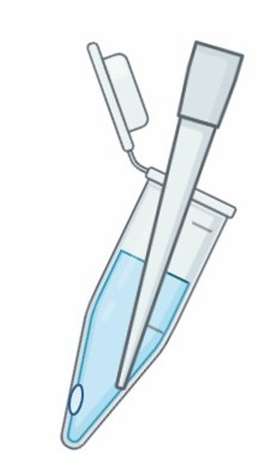{ width="220" loading=lazy }
</figure>

---

## Etapa 6 · Controle de qualidade após a fragmentação

Verifica a concentração e o perfil de tamanho do DNA após a fragmentação e a eliminação dos fragmentos curtos.

1. Quantificação: [Qubit dsDNA Broad Range](#quantificacao-de-dna-qubit)
2. Perfil de tamanho: [TapeStation, DNA genômico](#controle-de-qualidade-de-dna-genomico-tapestation)

---

## Etapa 7 · Preparo da biblioteca genômica

O DNA é preparado para o sequenciamento: as extremidades dos fragmentos são reparadas e recebem os adaptadores específicos da plataforma.

### Ligation Sequencing Kit V14 (SQK-LSK114)

**Antes de começar:**

- Extraia o DNA e verifique tamanho, quantidade e pureza (Etapas 1 a 6).
- Confira se todos os reagentes do kit, dos equipamentos e das empresas parceiras estão disponíveis.
- Verifique a *flow cell* para garantir um número suficiente de poros.
- O DNA deve ter concentração **acima de 22 ng/µL** para iniciar com os 1.000 ng recomendados.

!!! important "Compatibilidade"
    Este protocolo só pode ser usado com: Ligation Sequencing Kit V14 (SQK-LSK114), Control Expansion (EXP-CTL001), *flow cells* R10.4.1 e Flow Cell Wash Kit (EXP-WSH004).

!!! warning "Atenção"
    Use o **Ligation Buffer (LNB)** do kit e não substitua o Ligation Adapter (LA). Embora a empresa parceira recomende o tampão da própria ligase, a eficiência de ligação do adaptador é maior com o LNB.

??? abstract "Equipamentos e materiais (clique para expandir)"
    - 1 µg (ou 100–200 fmol) de DNA genômico ou *amplicon* de alto peso molecular, ou mais de 100 ng de DNA genômico de alto peso molecular se houver fragmentação
    - Ligation Sequencing Kit V14 (SQK-LSK114)
    - NEBNext Companion Module for Oxford Nanopore Technologies Ligation Sequencing (E7180S ou E7180L), ou os três produtos:
        - NEBNext FFPE DNA Repair Mix (M6630)
        - NEBNext Ultra II End Repair/dA-Tailing Module (E7546)
        - NEBNext Quick Ligation Module (E6056)
    - Tubos Eppendorf DNA LoBind de 1,5 mL e tubos de 0,2 mL para PCR
    - Água livre de nucleases e etanol 80% recém-preparado
    - Qubit, tubos para Qubit e kit Qubit dsDNA HS
    - Hula mixer, separador magnético para tubos de 1,5 mL, microcentrífuga, vórtex, termociclador, pipetas e ponteiras

### Reparo do DNA e *end-prep* (~35 minutos)

1. Descongele o DNA Control Sample (DCS) à temperatura ambiente, centrifugue brevemente, misture por pipetagem e coloque no gelo.
2. Prepare os reagentes NEBNext FFPE DNA Repair Mix e NEBNext Ultra II End Repair/dA-Tailing:
    - descongele no gelo;
    - agite e inverta o tubo para misturar;
    - os tampões Ultra II End Prep e FFPE DNA Repair podem ter um pequeno precipitado: deixe-os chegar à temperatura ambiente, pipete várias vezes e misture no vórtex por alguns segundos;
    - o tampão FFPE DNA Repair pode ser amarelado, o que não é problema.

    !!! danger "Não use o vórtex nas enzimas NEBNext FFPE DNA Repair ou NEBNext Ultra II End Prep."

3. Prepare o DNA em água livre de nucleases: transfira 1 µg (ou 100–200 fmol) para um tubo de 1,5 mL, ajuste o volume para 47 µL, misture por pipetagem e centrifugue brevemente.
4. Em um tubo de 0,2 mL, misture os reagentes abaixo, pipetando 10 a 20 vezes entre cada adição:

    | Reagente | Volume |
    | --- | ---: |
    | DNA CS (DCS) | 1 µL |
    | DNA | 47 µL |
    | NEBNext FFPE DNA Repair Buffer v2 | 7 µL |
    | NEBNext FFPE DNA Repair Mix | 2 µL |
    | Ultra II End-Prep Enzyme Mix | 3 µL |
    | **Total** | **60 µL** |

5. Confirme que a mistura está homogênea pipetando gentilmente e centrifugue brevemente.
6. No termociclador, incube a 20 °C por 5 minutos e a 65 °C por 5 minutos.
7. Ressuspenda as AMPure XP Beads (AXP) no vórtex (retire-as da geladeira 30 minutos antes).
8. Transfira a amostra para um tubo de 1,5 mL.
9. Adicione 60 µL das AXP ressuspendidas.
10. Incube no Hula mixer por 5 minutos à temperatura ambiente, ou inverta o tubo manualmente por 5 minutos.
11. Prepare 500 µL de etanol 80% em água livre de nucleases.
12. Centrifugue brevemente e coloque o tubo na estante magnética até o sobrenadante ficar límpido. Mantendo o tubo na estante, descarte o sobrenadante.
13. Ainda na estante, lave as *beads* com 200 µL de etanol 80% sem perturbá-las. Aguarde 30 segundos e descarte o etanol.
14. Repita o passo anterior.
15. Centrifugue, volte o tubo à estante e retire o etanol residual. Deixe secar por 30 segundos, sem deixar as *beads* rachar.
16. Retire o tubo da estante, ressuspenda o *pellet* em 61 µL de água livre de nucleases e incube por 2 minutos à temperatura ambiente.
17. Coloque na estante magnética por pelo menos 1 minuto, até o sobrenadante ficar límpido.
18. Transfira 61 µL do sobrenadante para um tubo de 1,5 mL.
19. Quantifique 1 µL no Qubit.

!!! success "Ponto de parada seguro"
    A amostra pode ser armazenada a 4 °C ou −20 °C durante a noite.

### Ligação do adaptador e limpeza (~20 minutos)

1. Centrifugue brevemente o Ligation Adapter (LA) e a Quick T4 Ligase e coloque no gelo.
2. Descongele o Ligation Buffer (LNB) à temperatura ambiente, centrifugue brevemente e misture por pipetagem (por ser viscoso, o vórtex é ineficiente). Coloque no gelo logo em seguida.
3. Descongele o Elution Buffer (EB) à temperatura ambiente, misture no vórtex, centrifugue brevemente e coloque no gelo.
4. Descongele o Long Fragment Buffer (LFB) ou o Short Fragment Buffer (SFB) à temperatura ambiente, misture no vórtex, centrifugue brevemente e coloque no gelo.

    !!! note "LFB ou SFB?"
        O **LFB** enriquece fragmentos acima de 3 kb. Para manter fragmentos de todos os tamanhos, use o **SFB**.

5. Em um tubo de 1,5 mL, misture na ordem abaixo, pipetando 10 a 20 vezes entre cada adição:

    | Reagente | Volume |
    | --- | ---: |
    | DNA da etapa anterior | 60 µL |
    | Ligation Buffer (LNB) | 25 µL |
    | NEBNext Quick T4 DNA Ligase | 10 µL |
    | Ligation Adapter (LA) | 5 µL |
    | **Total** | **100 µL** |

6. Confirme que a mistura está homogênea por pipetagem e centrifugue brevemente.
7. Incube por 10 minutos à temperatura ambiente.
8. Ressuspenda as AMPure XP Beads (AXP) no vórtex.
9. Adicione 40 µL das *beads* à reação e misture.
10. Incube no Hula mixer por 5 minutos à temperatura ambiente, ou inverta o tubo manualmente por 5 minutos.
11. Centrifugue brevemente, coloque na estante magnética e remova o sobrenadante.
12. Lave as *beads* com 250 µL de LFB ou SFB: misture, centrifugue brevemente, volte à estante e descarte o sobrenadante.
13. Repita o passo anterior.
14. Centrifugue brevemente, volte à estante e retire qualquer resíduo. Deixe secar por 30 segundos à temperatura ambiente, sem deixar as *beads* rachar.
15. Retire o tubo da estante e ressuspenda o *pellet* em 25 µL de EB. Centrifugue brevemente e incube por 10 minutos à temperatura ambiente. Para DNA de alto peso molecular, incubar a 37 °C pode melhorar a recuperação de fragmentos grandes.
16. Coloque na estante magnética por pelo menos 1 minuto, até o sobrenadante ficar límpido.
17. Transfira os 25 µL de sobrenadante com a biblioteca para um tubo limpo de 1,5 mL.
18. Quantifique 1 µL no Qubit.
19. Dilua a biblioteca para 10–20 fmol em volume final de 32 µL para o carregamento na *flow cell*. Para leituras longas, carregue cerca de 300 ng de DNA.

!!! important "Armazenamento"
    Armazene a biblioteca a 4 °C por pouco tempo, ou a −80 °C para períodos mais longos (até mais de 3 meses).

---

## Etapa 8 · Quantificação da biblioteca

Verifica a concentração final da biblioteca para carregar **300 ng de DNA** na *flow cell*. Se a biblioteca tiver menos de 300 ng, carregue todo o volume.

Use o protocolo [Qubit dsDNA **High Sensitivity (HS)**](#quantificacao-de-dna-qubit), que mede de 0,1 a 120 ng de DNA.

---

## Etapa 9 · Sequenciamento

Preparo da *flow cell*, carregamento da biblioteca e sequenciamento no PromethION 2.

**Equipamentos e materiais:** biblioteca preparada, Ligation Sequencing Kit V14 (SQK-LSK114), tubos Eppendorf DNA LoBind de 1,5 mL, microcentrífuga, vórtex, pipetas, ponteiras e PromethION 2.

### Preparo e carregamento da *flow cell*

1. Descongele o Sequencing Buffer (SB), as Library Beads (LIB) ou a Library Solution (LIS), o Flow Cell Tether (FCT) e o Flow Cell Flush (FCF) à temperatura ambiente. Misture no vórtex, centrifugue brevemente e mantenha no gelo.
2. Prepare a mistura de *priming* em um tubo adequado ao número de *flow cells* e misture no vórtex à temperatura ambiente:

    | Reagente | Volume por *flow cell* |
    | --- | ---: |
    | Flow Cell Flush (FCF) | 1.170 µL |
    | Flow Cell Tether (FCT) | 30 µL |
    | **Total** | **1.200 µL** |

3. No PromethION 2 Solo ou Integrated, posicione a *flow cell* na placa metálica e deslize-a para dentro do encaixe até que os pinos dourados ou a placa verde não fiquem mais visíveis.
4. Gire a tampa da porta de entrada (*inlet port*) no sentido horário para abri-la.
5. Retire um pequeno volume para eliminar bolhas de ar: ajuste uma P1000 para 200 µL, insira a ponteira na *inlet port* e gire a roda da pipeta até o visor marcar 220–230 µL, ou até ver um pouco de tampão entrar na ponteira.

    <figure markdown>
      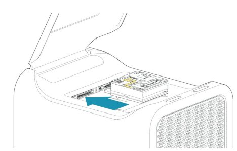{ width="300" loading=lazy }
      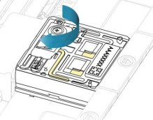{ width="300" loading=lazy }
      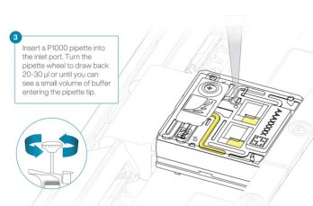{ width="300" loading=lazy }
      <figcaption>Encaixe da <em>flow cell</em>, abertura da <em>inlet port</em> e remoção de bolhas. Imagens adaptadas da Oxford Nanopore Technologies.</figcaption>
    </figure>

6. Carregue **500 µL** da mistura de *priming* pela *inlet port*, sem introduzir bolhas. Aguarde 5 minutos e, enquanto isso, prepare a biblioteca.
7. Misture bem as Library Beads (LIB) pipetando para cima e para baixo.
8. Em um tubo Eppendorf DNA LoBind de 1,5 mL, prepare a biblioteca para o carregamento:

    | Reagente | Volume por *flow cell* |
    | --- | ---: |
    | Sequencing Buffer (SB) | 100 µL |
    | Library Beads (LIB), bem homogeneizadas, ou Library Solution (LIS) | 68 µL |
    | Biblioteca de DNA | 32 µL |
    | **Total** | **200 µL** |

9. Complete o *priming* adicionando lentamente mais **500 µL** da mistura pela *inlet port*.
10. Misture delicadamente a biblioteca por pipetagem imediatamente antes do carregamento.
11. Carregue **200 µL** da biblioteca na *inlet port* com uma P1000.
12. Feche a válvula da *inlet port* e aguarde 10 minutos antes de iniciar o sequenciamento.
13. Se a proteção contra luz (*light shield*) tiver sido removida, reinstale-a: alinhe o recorte da proteção com a tampa da *inlet port*, com a borda frontal acima do ID da *flow cell*, e pressione até o clipe encaixar com um clique.

<figure markdown>
  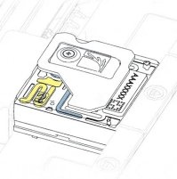{ width="320" loading=lazy }
</figure>

### Iniciando o sequenciamento no MinKNOW

O MinKNOW controla o equipamento, a aquisição dos dados e o *basecalling* em tempo real.

1. Dê duplo clique no ícone do MinKNOW.
2. Clique em **Log in with your Nanopore account** e entre com seu e-mail e senha da Nanopore.
3. No **Connection Manager**, clique no cartão **My device** para controlar o equipamento.
4. Na página inicial, clique em **Start Sequencing**.
5. Na aba **Positions**, informe o nome do experimento e o **Sample ID**, selecione o tipo e a posição da *flow cell* e clique em **Continue to kit selection**.
6. Selecione o kit utilizado (**SQK-LSK114**) e clique em **Continue to run options**.
7. Defina a duração da corrida e o comprimento mínimo das leituras, ou mantenha o padrão. Clique em **Continue to analysis**.
8. Escolha o modelo de *basecalling* **SUP (Super Accuracy)** e as opções de *barcoding* e alinhamento, ou mantenha o padrão. Clique em **Continue to output**.
9. Defina o local, o formato e os filtros dos dados. **Salve os dados brutos (POD5) e as leituras (FASTQ).** Clique em **Continue to final review**.
10. Clique em **Start**.

### Lavagem e armazenamento da *flow cell*

A lavagem digere a biblioteca presente na *flow cell* e libera os poros para uma nova corrida. Em geral, uma *flow cell* pode ser lavada e reutilizada de 3 a 6 vezes.

!!! note "Registre"
    Espécie · ID do DNA · ID da *flow cell* · número de poros.

<figure markdown>
  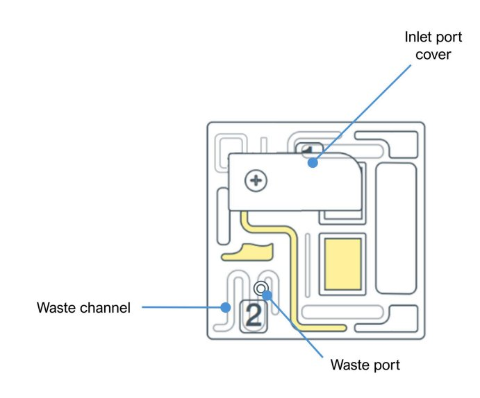{ width="360" loading=lazy }
  <figcaption>Estrutura da <em>flow cell</em>: <em>inlet port</em>, canal de descarte (<em>waste channel</em>) e porta de descarte (<em>waste port</em>).</figcaption>
</figure>

**Materiais:** Flow Cell Wash Kit (EXP-WSH004 ou EXP-WSH004-XL), pipetas, ponteiras e tubos Eppendorf de 1,5 mL.

**Lavagem:**

1. Mantenha a *flow cell* no P2 Solo durante toda a lavagem e, sempre que possível, com a proteção contra luz.
2. Prepare o *wash mix* no momento da lavagem. Não use mistura preparada há mais de um dia.
3. Coloque o tubo de Wash Mix (WMX) no gelo, sem vórtex.
4. Descongele o diluente (DIL) à temperatura ambiente, misture no vórtex, centrifugue brevemente e coloque no gelo.
5. Em um tubo de 1,5 mL, misture por pipetagem (sem vórtex) e mantenha no gelo:

    | Reagente | Volume |
    | --- | ---: |
    | Wash Mix (WMX) | 2 µL |
    | Wash Diluent (DIL) | 398 µL |

6. Pare ou pause o sequenciamento e confirme que a tampa da *inlet port* está fechada.
7. Retire todo o líquido do canal de descarte, aspirando lentamente com uma pipeta de 1.000 µL.

    <figure markdown>
      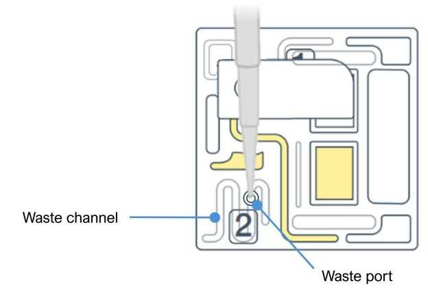{ width="320" loading=lazy }
    </figure>

8. Abra a *inlet port* e retire 20–30 µL com uma pipeta de 1.000 µL, girando lentamente a roda a partir de 200 µL. **Nunca pressione o êmbolo; sempre gire a roda.**
9. Carregue lentamente 200 µL do *wash mix* na *inlet port*, em pelo menos 5 segundos.
10. Incube por 5 minutos.
11. Carregue mais 200 µL do *wash mix*.
12. Feche a *inlet port* e incube por 1 hora.
13. Retire todo o líquido dos canais de descarte.
14. A *flow cell* pode então receber uma nova biblioteca ou ser armazenada.

**Armazenamento:**

1. Descongele um tubo de Storage Buffer (S) à temperatura ambiente.
2. Abra a *inlet port* e retire 20–30 µL com uma pipeta de 1.000 µL ajustada para 200 µL, girando lentamente a roda.
3. Carregue lentamente 500 µL de Storage Buffer (S), girando a roda da pipeta, em pelo menos 5 segundos.
4. Feche a *inlet port*.
5. Retire todo o líquido dos canais de descarte.
6. Faça um **Flow Cell Check** e anote o número de poros restantes.
7. Armazene a *flow cell* entre 2 °C e 8 °C.

---

## Protocolos de apoio

### Controle de qualidade de DNA genômico (TapeStation)

Eletroforese automatizada em microescala para avaliar a integridade e o tamanho do DNA de alto peso molecular no **Agilent 4150 TapeStation** (até 16 amostras por corrida), com os reagentes Agilent Genomic DNA. A Genomic DNA ScreenTape tem resolução para fragmentos de até **60.000 pb**.

<figure markdown>
  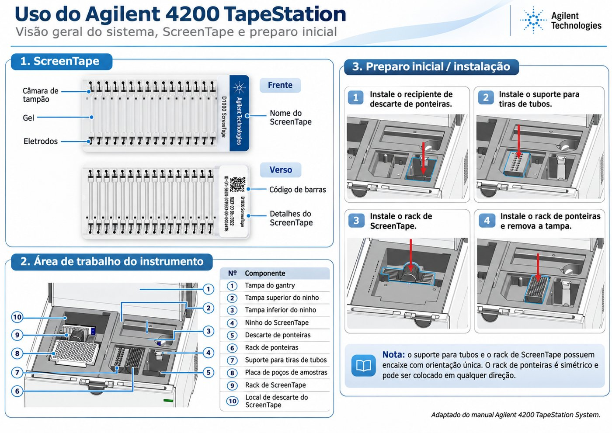{ width="620" loading=lazy }
  <figcaption>Visão geral do sistema, da ScreenTape e do preparo inicial. Adaptado do manual Agilent TapeStation.</figcaption>
</figure>

??? abstract "Reagentes e materiais (clique para expandir)"
    - Agilent 4150 TapeStation (G2992AA)
    - Agitador tipo vórtex IKA MS3 e vórtex de bancada
    - Tiras de 8 tubos ópticos para PCR (401428) e tampas (401425)
    - Ponteiras de carregamento para TapeStation (5067-5598 ou 5067-5599)
    - Microcentrífuga para tubos de 1,5 mL
    - Agilent Genomic DNA ScreenTape (5067-5365), armazenada a 4 °C
    - Agilent Genomic DNA Reagents (5067-5366), com Genomic DNA Sample Buffer e ladder, armazenados a 4 °C

**Preparo:**

1. Deixe os reagentes e a ScreenTape à temperatura ambiente por 30 minutos.
2. Misture no vórtex o Genomic DNA Sample Buffer e centrifugue.
3. **Não** use o vórtex no Genomic DNA Ladder (tampa amarela).

**Ladder e amostras (1 a 15 amostras):**

1. Na primeira posição de uma tira de 8 tubos, pipete 10 µL de Genomic DNA Sample Buffer e 1 µL de Genomic DNA Ladder. Marque essa posição como **A1**.
2. Em cada um dos demais tubos, combine 10 µL de Genomic DNA Sample Buffer e 1 µL da amostra de DNA.
3. Agite a tira no vórtex IKA a 2.000 rpm por 1 minuto.
4. Centrifugue rapidamente para coletar as gotas no fundo.

**Corrida:**

1. Ligue o computador e abra o software **Controller**. Ligue o TapeStation pelo botão frontal.
2. Abra a tampa e insira a ScreenTape no slot superior direito (até 15 amostras + 1 ladder). Confira se o software reconheceu a fita, o tipo e a validade.
3. No Controller, selecione as posições dos tubos e informe o nome de cada amostra. O software indica quantas ScreenTapes e ponteiras serão necessárias.
4. Confira se há ponteiras suficientes; se não, troque a caixa.
5. Retire as tampas da tira e coloque-a no equipamento na posição indicada, com o ladder em **A1**.
6. Feche a tampa e clique em **Start Run**.
7. Ao final, gere o relatório no **Agilent TapeStation Analysis Software** e salve na pasta *Reports*.

### Quantificação de DNA (Qubit)

O Qubit (ThermoFisher) quantifica DNA dupla fita por fluorometria, com alta sensibilidade. É a medida usada para o sequenciamento.

=== "Broad Range (BR)"

    - **Faixa:** 4 a 2.000 ng de DNA.
    - **Uso no curso:** Etapas 2, 5 e 6.
    - **Kit:** Qubit dsDNA BR Assay Kit (Q32850 ou Q32853).
    - **Tipo de ensaio no equipamento:** *dsDNA Broad Range*.

=== "High Sensitivity (HS)"

    - **Faixa:** 0,1 a 120 ng de DNA.
    - **Uso no curso:** Etapas 7 e 8 (biblioteca).
    - **Kit:** Qubit dsDNA HS Assay Kit (Q32851 ou Q32854).
    - **Tipo de ensaio no equipamento:** *dsDNA High Sensitivity*.

**Materiais:** kit Qubit (BR ou HS), Qubit Assay Tubes (Q32856) ou Qubit Flex Assay Tube Strips (Q33252), vórtex e microcentrífuga.

!!! tip "Temperatura"
    Retire os reagentes da geladeira pelo menos 30 minutos antes. Eles funcionam melhor à temperatura ambiente, e variações de temperatura afetam a exatidão.

<figure markdown>
  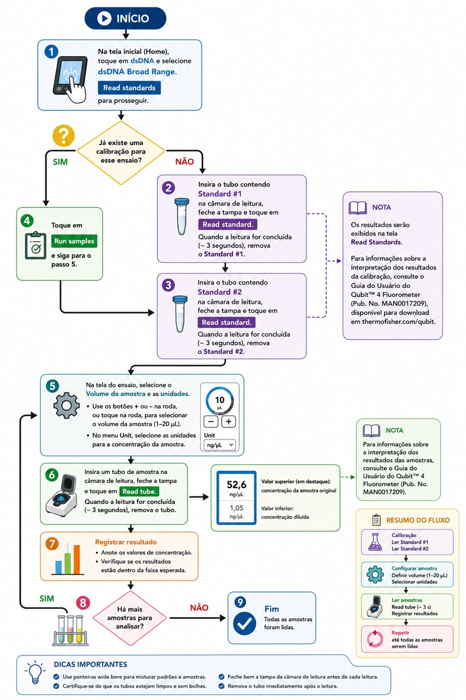{ width="520" loading=lazy }
  <figcaption>Resumo do fluxo de quantificação no Qubit.</figcaption>
</figure>

**1. Solução de trabalho para os *standards*** (em tubo de 1,5 mL; nunca use tubo de vidro). Misture no vórtex por 3 a 5 segundos.

| Reagente | Volume |
| --- | ---: |
| Qubit Buffer | 398 µL |
| Fluoróforo | 2 µL |
| **Total** | **400 µL** |

**2. *Standards*** (em tubos próprios do Qubit, identificados na tampa como #1 e #2). Misture no vórtex por 3 a 5 segundos, centrifugue rapidamente e incube por 2 minutos à temperatura ambiente.

| Reagente | Standard #1 | Standard #2 |
| --- | ---: | ---: |
| Solução de trabalho | 190 µL | 190 µL |
| Standard | 10 µL | 10 µL |
| **Total** | **200 µL** | **200 µL** |

**3. Amostras** (em tubos próprios do Qubit, identificados na tampa). Misture no vórtex por 3 a 5 segundos, centrifugue rapidamente e incube por 2 minutos à temperatura ambiente.

| Reagente | Volume |
| --- | ---: |
| Qubit Buffer | 198 µL |
| Fluoróforo | 1 µL |
| Amostra | 1 µL |
| **Total** | **200 µL** |

**4. Leitura:**

1. Na tela inicial, toque em **dsDNA** e selecione o tipo de ensaio (*Broad Range* ou *High Sensitivity*). Toque em **Read standards**. *Se o equipamento já estiver calibrado, siga para a leitura das amostras.*
2. Insira o Standard #1, feche a tampa e toque em **Read standard** (~3 segundos). Retire o tubo.
3. Repita com o Standard #2.
4. Toque em **Run samples**.
5. Selecione o volume de amostra usado (1 µL) e a unidade (ng/µL).
6. Insira cada tubo de amostra, feche a tampa e toque em **Read tube**. O valor maior, no alto, é a concentração da amostra original; o menor é a da amostra diluída.
7. Repita a leitura para todas as amostras.

Para interpretar a calibração e os resultados, consulte o *Qubit 4 Fluorometer User Guide* (MAN0017209), disponível no site da Thermo Fisher.

---

*Apostila de protocolos do Laboratório de Genética & Biodiversidade (LGBio/ICB), Universidade Federal de Goiás.*
