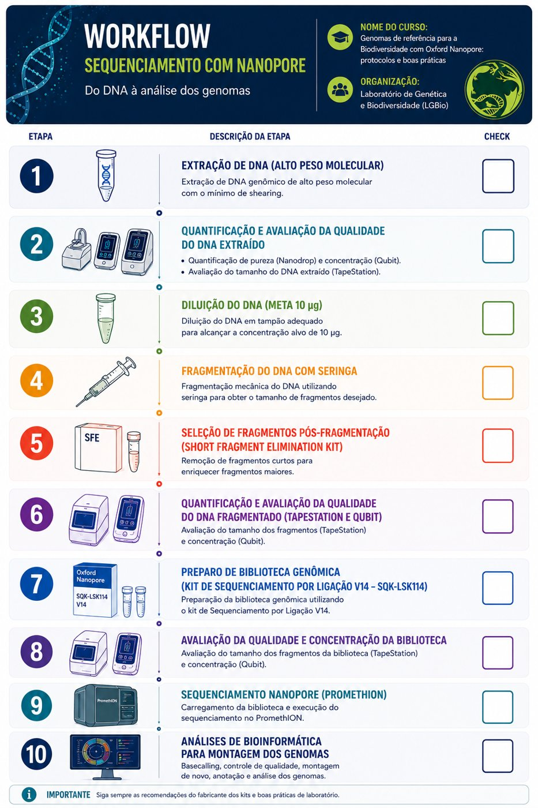

# Curso de Montagem de Genomas de Referência com dados Nanopore

!!! info "Edição 2026"
    **16 a 27 de novembro de 2026** · Laboratório de Genética & Biodiversidade (LGBio), Instituto de Ciências Biológicas I, Campus II da Universidade Federal de Goiás, Goiânia (GO), Brasil.

## :material-information: Informações gerais

| Item | Detalhe |
| --- | --- |
| **Datas** | 16 a 27 de novembro de 2026 (duas semanas) |
| **Local** | LGBio/ICB, Universidade Federal de Goiás (UFG), Goiânia |
| **Modalidade** | Presencial |
| **Idioma** | Português |
| **Coordenação** | Dra. Mariana Pires de Campos Telles |
| **Responsáveis** | Dra. Mariana Pires de Campos Telles, Dra. Cíntia Pelegrineti Targueta, Dra. Carmen Elena Barragan Ruiz, Dra. Renata de Oliveira Dias, Dr. Rhewter Nunes e Dra. Ramilla dos Santos Braga Ferreira |

## :material-text-box-outline: Ementa

O curso aborda os princípios, protocolos e ferramentas necessários para a geração de genomas de referência da biodiversidade, seguindo as recomendações de qualidade internacionais do [Earth BioGenome Project (EBP)](https://www.earthbiogenome.org/). São apresentadas todas as etapas do fluxo de trabalho: planejamento amostral, obtenção de DNA de alto peso molecular, preparo de bibliotecas Oxford Nanopore, sequenciamento de leitura longa, controles de qualidade, montagem dos genomas, *scaffolding*, anotação, curadoria e disponibilização dos dados em repositórios públicos.

A parte prática inclui o preparo de bibliotecas com o *Ligation Sequencing Kit* (SQK-LSK114), o sequenciamento na plataforma Oxford Nanopore PromethION 2 (P2) e a execução de *pipelines* de bioinformática para montagem e avaliação de genomas de referência.

!!! warning "Pré-requisito"
    É necessário iniciar o curso com o **DNA de alto peso molecular já extraído**.

## :material-sitemap-outline: Fluxo de trabalho

<figure markdown>
  { width="520" loading=lazy }
  <figcaption>Fluxo de trabalho do curso, do DNA à análise dos genomas.</figcaption>
</figure>

## :material-book-open-variant: Módulos

-   :material-flask-outline:{ .lg .middle } __Parte 1 · Bancada__

    ---

    Controle de qualidade do DNA, fragmentação, seleção de fragmentos, preparo de biblioteca (SQK-LSK114) e sequenciamento no PromethION 2.

    :octicons-check-circle-fill-24:{ .green } **Disponível**

    [:octicons-arrow-right-24: Protocolos de bancada](bancada.md)

-   :material-console:{ .lg .middle } __Parte 2 · Bioinformática__

    ---

    Controle de qualidade das leituras, montagem, avaliação, *scaffolding*, anotação, curadoria e depósito dos dados.

    :octicons-clock-fill-24:{ .yellow } **Em construção**

    [:octicons-arrow-right-24: Bioinformática](bioinformatica.md)

